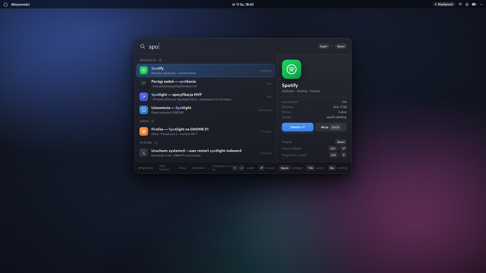

# Spotlight

Launcher w stylu macOS Spotlight dla GNOME Shell (45–51). Jedno pole, wyniki z
aplikacji, otwartych okien, plików (Tracker/localsearch, własny indeks ścieżek
projektów i fallback `locate`), paneli Ustawień GNOME, komend powłoki,
kalkulatora i historii schowka — z podglądem, menu akcji i frecency.

Repozytorium: **https://github.com/Haniewicz/gnome-spotlight** — projekt
nie jest (na razie) publikowany w GNOME Extensions; instalacja odbywa się
z GitHuba (patrz niżej).

Wizualna referencja: `mockup/launcher.html` oraz `mockup/spotlight-*.png`.
Specyfikacja: `docs/DESIGN.md`.

Przy `enable()` rozszerzenie asynchronicznie rozgrzewa cache aplikacji, paneli Ustawień i indeksu plików, dzięki czemu pierwsze wpisanie nie płaci zimnego kosztu providerów.

## Wymagania

- GNOME Shell 45–51 (testowane na 51.1) i gjs 1.90+.
- `git`, `python3`, `unzip`, `gnome-extensions` (pakiet `gnome-shell`).
- Opcjonalnie [Blur my Shell](https://extensions.gnome.org/extension/3193/blur-my-shell/)
  (`blur-my-shell@aunetx`) — odpowiada za efekt rozmycia tła panelu; bez niego
  blur jest wyłączony, a panel pozostaje półprzezroczysty.
- Do plików: `localsearch` (Tracker 3.12, usługa `localsearch-3.service`) —
  zalecane, bo daje wyniki po nazwie i treści. `locate` (pakiet
  `mlocate`/`plocate`) jest fallbackiem; bez żadnego z nich sekcja plików jest
  po prostu pusta.
- Terminal (`gnome-terminal` albo GNOME Console/kgx) dla prefiksu `>`.
- Do testów: `gjs` i `glib-compile-schemas`; do smoke dodatkowo
  `dbus-run-session` i sesyjny GNOME Shell w trybie headless.

## Instalacja (z GitHub)

Projekt **nie jest jeszcze publikowany w GNOME Extensions** — instalujemy
bezpośrednio z repozytorium:

```bash
git clone https://github.com/Haniewicz/gnome-spotlight.git
cd gnome-spotlight
bash tools/install.sh
```

`tools/install.sh`:
- pakuje rozszerzenie (`gnome-extensions pack` ze schematem i `lib/`),
- instaluje je w `~/.local/share/gnome-shell/extensions/spotlight@haniewicz.dev`,
- instaluje i uruchamia daemon `gnome-spotlightd` (`tools/install-daemon.sh`),
- próbuje włączyć rozszerzenie i sprawdza `gnome-extensions info`.

**Pierwsza instalacja:** GNOME Shell poznaje nowe UUID dopiero po restarcie
sesji. Jeśli skrypt zakończy się komunikatem, że rozszerzenie nie jest jeszcze
`ACTIVE`, **wyloguj się i zaloguj ponownie**, a potem:

```bash
gnome-extensions enable spotlight@haniewicz.dev
gnome-extensions prefs spotlight@haniewicz.dev
```

Preferencje pozwalają ustawić skrót (domyślnie `Super + Space`), providery,
limit wyników i wygląd panelu.

### Sama wtyczka, bez daemona

Daemon przyspiesza wyniki i obsługuje część providerów, ale rozszerzenie działa
także w trybie `offline` (wolniej). Instalacja ręczna samej wtyczki:

```bash
DEST="$HOME/.local/share/gnome-shell/extensions/spotlight@haniewicz.dev"
mkdir -p "$DEST"
cp -R extension.js prefs.js metadata.json stylesheet.css lib schemas "$DEST"/
glib-compile-schemas "$DEST/schemas"
```

Następnie wyloguj się i zaloguj, po czym uruchom
`gnome-extensions enable spotlight@haniewicz.dev`.

### Aktualizacja

```bash
cd gnome-spotlight
git pull
bash tools/install.sh
```

Po aktualizacji kodu **wyloguj się i zaloguj ponownie** — GNOME Shell cache'uje
moduły ESM rozszerzenia, więc sam `disable/enable` nie wczyta nowej wersji.
Daemon jest aktualizowany i restartowany przez `tools/install-daemon.sh`.

### Odinstalowanie

```bash
gnome-extensions disable spotlight@haniewicz.dev
rm -rf "$HOME/.local/share/gnome-shell/extensions/spotlight@haniewicz.dev"
systemctl --user disable --now gnome-spotlightd 2>/dev/null || true
rm -rf "$HOME/.local/lib/gnome-spotlightd"
rm -f "$HOME/.config/systemd/user/gnome-spotlightd.service"
systemctl --user daemon-reload 2>/dev/null || true
```

Wariant z innym UUID (np. do testów obok zainstalowanej wersji) obsługuje
`bash tools/deploy.sh --uuid-suffix test`.

## Co zawiera `dist/`

Wydanie buduje `tools/package-release.sh [--version X.Y.Z]`; wersja domyślnie
pochodzi z `metadata.json`, a `--version` nadpisuje ją tylko w kopii stagingowej
(repozytoryjny `metadata.json` pozostaje bez zmian). Katalog `dist/<wersja>/`
zawiera trzy pliki:

| Plik | Zawartość |
|---|---|
| `spotlight@haniewicz.dev.shell-extension.zip` | rozszerzenie GNOME Shell (kod, `lib/`, schemat GSettings) |
| `gnome-spotlightd-<wersja>.tar.gz` | `searchd/`, `lib/`, `tools/install-daemon.sh`, `README.md`, `DESIGN.md` |
| `SHA256SUMS.txt` | sumy SHA-256 obu artefaktów |

Skrypt jest idempotentny (kolejne uruchomienie nadpisuje `dist/<wersja>/`), nie
dotyka `~/.local` i niczego nie publikuje. Weryfikacja artefaktów:

```bash
sha256sum -c dist/<wersja>/SHA256SUMS.txt
```

## Skrót

Domyślnie `Super + Space`. Skrót można zmienić w preferencjach (4 warianty:
`Super+Space`, `Super+Enter`, `Ctrl+Space`, `Super+S`). Jeśli Shell ma konflikt
z innym skrótem (np. przełączaniem języka), Shell rozstrzyga go sam — Spotlight
nie nadpisuje cudzych skrótów.

## Prefiksy

| Prefiks | Tryb | Źródło wyników | Akcje |
|---|---|---|---|
| `>` | komendy | dowolne polecenie wpisane po prefiksie | uruchom w terminalu (`gnome-terminal`/`kgx`), kopiuj polecenie |
| `ssh ` | SSH | aliasy z `~/.ssh/config` (cache 60 s; `Host *`, wildcardy i `Match` pomijane) | połącz przez SSH w terminalu, kopiuj adres |
| `sys ` | usługi | jednostki `systemctl --user` przez D-Bus (`Manager.ListUnits`, tylko `Loaded`) | start / stop / restart / status; zmiany stanu przez `Manager.<Verb>Unit`, bez powłoki |
| `snip ` | snippety | `$XDG_CONFIG_HOME/gnome-spotlight/snippets.json` | wstaw tekst do schowka |
| `docker ` | kontenery | `docker ps --format` albo `podman ps --format`, gdy docker nie jest w `PATH` | otwórz logi, zatrzymaj kontener; bez powłoki, subprocess z timeoutem 300 ms |
| `f ` | pliki | Tracker/localsearch, fallback `locate` | otwórz plik, pokaż w plikach, kopiuj ścieżkę |
| `cb ` / `clip…` | schowek | lokalna historia Shella | wstaw z historii, usuń wpis (`Ctrl+Enter`) |

- `>` — komendy powłoki, np. `> systemctl --user restart spotify` (uruchamiane
  w terminalu, nigdy bezpośrednio przez proces Shella).
- `f ` — zawężenie do plików, np. `f raport 2024`. Spacja po `f` jest częścią
  prefiksu, dzięki czemu zwykłe zapytania typu `firefox` działają normalnie.
- `ssh `, `sys `, `snip ` i `docker ` ustawiają tryb daemona już podczas
  pisania; aktywny tryb jest widoczny w stopce modala. Zapytanie po prefiksie
  zawęża listę (np. `sys spotify` albo `ssh prod`), a sam prefiks pokazuje
  wszystkie pozycje danego źródła.
- `snip ` wstawia snippet tylko do schowka. Wklejanie do aktywnego okna nie jest
  implementowane, bo wymagałoby przejęcia fokusu i wstrzyknięcia klawisza.
- `cb ` albo `clip…` — historia schowka, np. `cb raport` albo `clip raport`.
  Wpis pojawia się po otwarciu modala; `Enter` wstawia jego treść z powrotem do
  schowka, a `Ctrl+Enter` usuwa wpis z historii. Historia jest lokalna dla
  Shella i zapisywana w `$XDG_CACHE_HOME/gnome-spotlight/clipboard.json`.
- Bez prefiksu przeszukiwane są wszystkie włączone providery.

Plik snippetów to tablica obiektów (albo mapa `keyword -> obiekt/tekst`):

```json
[
  { "keyword": "sig", "name": "Podpis", "text": "Jan Kowalski\njan@example.com" }
]
```

`keyword` jest pojedynczym słowem (bez spacji), `text` jest wymagany, a `name`
jest opcjonalne (domyślnie równe `keyword`). Uszkodzony JSON oznacza pustą
listę, nie błąd launchera.

## Klawisze

| Klawisz | Akcja |
|---|---|
| `↑` / `↓` | wybór wyniku |
| `Tab` / `Shift+Tab` | następna / poprzednia sekcja (w jednej sekcji: następny / poprzedni wynik) |
| `Enter` | akcja domyślna |
| `Ctrl+Enter` | akcja alternatywna (np. kopiuj ścieżkę) |
| `Ctrl+Space` | rozwija panel podglądu (sidebar) dla zaznaczonego wyniku; drugie `Ctrl+Space` zwija go z powrotem |
| `Ctrl+K` | menu akcji zaznaczonego wyniku |
| `Ctrl+P` | przypnij/odepnij od „Częste” (flaga w historii użycia) |
| `Print` | otwiera systemowy interfejs zrzutu ekranu także przy otwartym launcherze |
| `Ctrl+Print` | zapisuje pełny zrzut do `~/Pictures/Spotlight-RRRRMMDD-GGMMSS.png` (fallback: katalog domowy) |
| `Esc` | w podglądzie zwija sidebar, poza nim zamyka modal |

Menu akcji zawiera tylko akcje możliwe do wykonania; np. „Uruchom w terminalu”
jest wyszarzone, gdy nie ma zainstalowanego terminala. Zamknięcie menu nie
zamyka modala. Ten sam panel otwiera przycisk `Akcje ⌃K` w podglądzie wyniku;
`Ctrl+Enter` nadal wykonuje akcję alternatywną (np. „Kopiuj ścieżkę”).

### Akcje z daemona

Wyniki z `gnome-spotlightd` niosą akcje jako opis JSON (`app`, `file`,
`settings`, `copy`, `command`, `systemd`, `reveal`, `docker-stop`, `remote`).
D-Bus opakowuje każdą wartość `a{sv}` w `GLib.Variant`, dlatego
`parseActions()` rozpakowuje warianty (zarówno `Variant<string>` z JSON-em, jak
i `Variant<a{sv}>`) przez `deepUnpack()`/`deep_unpack()`; `lib/searchStream.js`
normalizuje `actions` już na wejściu strumienia. `lib/action-runner.js`
zamienia ten opis na efekt w Shellu; `Enter` i kliknięcie wiersza przechodzą
przez tę samą ścieżkę (`_activateResult()`). Akcje `remote` są przekazywane do
daemona metodą `Activate(id)` na `org.gnome.Spotlight.Search`, która wywołuje
`SearchProvider2.ActivateResult` u natywnego providera. Wyniki `app`/`file` są
obsługiwane lokalnie przez Shell (`Shell.AppSystem` i `Gio.AppInfo`), więc nie
wymagają uruchamiania aplikacji przez daemona.

### Akcje okien

Na wynikach providera `windows` (okno aplikacji z listy otwartych okien) menu
`Ctrl+K` zawiera akcje geometrii i zarządzania oknem. Wpisy są wyszarzone, gdy
okno nie zgłasza odpowiedniej możliwości (`can_close`, `can_minimize`,
`allows_move`, `allows_resize`, `can_maximize`), więc niedostępna akcja nigdy
nie wykonuje się w tle.

| `id` | Akcja | Warunek aktywności | Wykonanie |
|---|---|---|---|
| `tile-left` | Przytnij w lewo | okno można przesuwać i zmieniać rozmiar | `Meta.Window.tile(Meta.TileMode.LEFT)`, a bez tiling-u `planTile()` + `move_resize_frame()` |
| `tile-right` | Przytnij w prawo | jak wyżej | `Meta.Window.tile(Meta.TileMode.RIGHT)`, a bez tiling-u `planTile()` + `move_resize_frame()` |
| `maximize` | Maksymalizuj | `can_maximize`, okno można przesuwać i zmieniać rozmiar | `Meta.Window.maximize()`, a bez tej metody `planCenter()` (90% pracy) + `move_resize_frame()` |
| `move-workspace-1` … `move-workspace-4` | Przenieś na przestrzeń 1–4 | `allows_move` i istnieje dana przestrzeń | `change_workspace()` + `activate()` |
| `minimize` | Minimalizuj | `can_minimize` | `Meta.Window.minimize()` |
| `close` | Zamknij | `can_close` | `Meta.Window.close()`, a w starszym Mutterze `delete()` |

Planista `lib/window-actions.js` jest czystym modułem (bez `Meta`/`St`), więc
dzieli się na pół ekranu bez 1-px szczeliny również na monitorach o nieparzystej
szerokości i z ujemnym początkiem. Współpracuje z `splittiling@haniewicz.dev`:
gdy Mutter udostępnia `tile()`, to on rozstrzyga geometrię, a planista jest tylko
fallbackiem, więc rozszerzenia nie muszą być włączane razem.

## Preferencje

Okno Adwaita pozwala ustawić skrót, włączać/wyłączać providery, wybrać limit
wyników (suwak 5–20, domyślnie 10), przełącznik panelu podglądu, monitor otwierania
(`pointer` / `focused` / `primary`), a także włączyć historię schowka i
wyczyścić ją przyciskiem „Wyczyść historię”. Osobna sekcja „Indeks ścieżek”
pozwala edytować listę korzeni (`extra-index-roots`, np. `$HOME/Projects,
$HOME/Dokumenty`) i ustawić maksimum wpisów suwakiem 50 000–500 000
(`path-index-max-entries`, domyślnie 200 000). Wszystkie wartości są zapisywane
przez `this.getSettings()`; puste lub uszkodzone wartości nie powodują wyjątków.

## Wygląd

Panel startuje jako wąska lista wyników — sidebar podglądu jest domyślnie
ukryty i nie rezerwuje miejsca (lista ma pełną szerokość modala). Rozwija go
dopiero `Ctrl+Space`; to samo skrócenie albo `Esc` zwija panel z powrotem.

Na początku okna preferencji znajduje się grupa **„Wygląd”**:



- **Krycie panelu** — suwak 50–100% (`panel-opacity`, domyślnie 93%);
  natychmiast zmienia `rgba(26,27,34,<krycie>)` tła panelu,
- **Rozmycie tła (blur)** — opcjonalny przełącznik (`blur-enabled`, domyślnie
  wyłączony),
- **Promień rozmycia** — suwak 0–48 px (`blur-radius`, domyślnie 24), aktywny
  tylko przy włączonym blurze.

Blur rozmywa to, co jest pod panelem: klonuje dwie warstwy — tapetę
(`Main.layoutManager._backgroundGroup`) i okna (`global.window_group`) — do
kontenera o rozmiarze panelu, a półprzezroczysta ciemna warstwa
(`1 - panel-opacity + 0.15`) chroni czytelność tekstu. Welur rysuje też
delikatną 1 px obwódkę `rgba(255,255,255,0.16)` (tę samą co w trybie bez
blurra), która odcina panel od tła bez dokładania drugiego zaokrąglonego
kształtu. Rozmycie i zaokrąglenie rogów (18 px) wykonuje **jeden** efekt — `DualKawaseBlurEffect` z rozszerzenia
[Blur my Shell](https://extensions.gnome.org/extension/3193/blur-my-shell/)
(`blur-my-shell@aunetx`): jego shader wyjściowy zna rzeczywiste (powiększone o
padding) granice rozmycia i przycina zaokrąglony kształt do powierzchni aktora,
więc w narożnikach nie zostają ostre, prostokątne skrawki. Wcześniejsza wersja
łączyła `Shell.BlurEffect` z osobną maską `Clutter.ShaderEffect`; dziecko z
efektem rozmycia powiększa bufor pośredni przodka, a maska liczona z rozmiaru
aktora nie trafiała wtedy w jego rogi (widoczne „zepsute rogi”). Z tego powodu
Blur my Shell jest **wymagany** do działania blurra: gdy rozszerzenie nie jest
zainstalowane lub włączone, blur jest wyłączany i zostaje sam półprzezroczysty
panel (bez ryzyka narysowania popsutych rogów). Kontener tła nie wpływa na
wysokość panelu. Blur jest **wyłączony domyślnie**, bo rozmycie w czasie
rzeczywistym zużywa GPU i może obciążać słabsze karty; w razie potrzeby obniż
promień. Wszystkie trzy ustawienia działają na żywo, bez przycisku „Zapisz”.

Do weryfikacji pikselowej rogów na zrzucie służy `tools/corner-check.py`:

```bash
python3 tools/corner-check.py screenshot.png --rect 210,100,860,420 --radius 18
```

Narzędzie porównuje jasność małych kwadratów w narożnikach z środkiem panelu
i kończy się kodem 0, gdy żaden róg nie jest ciemniejszy o 6% lub więcej.

## Natywne providery GNOME

Daemon konsumuje aplikacje, które same rejestrują się jako
`org.gnome.Shell.SearchProvider2`. Deskryptory są czytane przy starcie z:

- `~/.local/share/gnome-shell/search-providers/*.ini` (użytkownika),
- `/usr/share/gnome-shell/search-providers/*.ini` (systemowe).

Wyniki trafiają do osobnych sekcji `remote:<BusName>` (np.
`remote:org.gnome.Settings.SearchProvider`, `remote:org.gnome.Calculator.SearchProvider`)
z rodzajem `Natywne`. Launcher nie uruchamia aplikacji przy wpisywaniu i nie
odpytuje nieuruchomionych providerów: najpierw sprawdzany jest właściciel nazwy
D-Bus (`NameHasOwner`), a bez właściciela provider jest pomijany bez wpisu w
`errors` (licznik `skipped`). Proxy powstaje z `DO_NOT_AUTO_START` i
`DO_NOT_LOAD_PROPERTIES`, więc `AutoStart=true` z pliku `.ini` nie omija tej
reguły. Każde wywołanie `GetInitialResultSet` i `GetResultMetas` ma budżet
80 ms, cały provider `remote` odpowiada w maksymalnie 100 ms, a z remote
wracają najwyżej 3 najlepiej ocenione wyniki (dedupe po `busName + remoteId`).
Błąd albo timeout jednego providera nie usuwa wyników pozostałych. Własny bus
name `org.gnome.Spotlight` jest pomijany, podobnie jak deskryptory bez
`BusName`/`ObjectPath`.

Lista znalezionych plików bez uruchamiania daemona:

```bash
ls ~/.local/share/gnome-shell/search-providers/*.ini \
   /usr/share/gnome-shell/search-providers/*.ini 2>/dev/null
```

Aby wyłączyć konsumowanie natywnych aplikacji, użyj przełącznika
„Wyniki z natywnych aplikacji (Ustawienia, Kalkulator…)” w preferencjach
(klucz GSettings `remote-providers-enabled`, domyślnie `true`). Zmiana jest
czytana przy starcie daemona; po przełączeniu uruchom go ponownie:

```bash
systemctl --user restart gnome-spotlightd.service
# wariant bez systemd: zatrzymaj i uruchom ponownie `gjs -m searchd/main.js`
```

## Źródła plików

Daemon pyta lokalny indeks GNOME (`localsearch` / Tracker 3.12,
`org.freedesktop.Tracker3.Miner.Files`) **oraz własny indeks ścieżek**.
Tracker odpowiada za nazwy i zawartość dokumentów poza repozytoriami. Nie
indeksuje jednak wnętrza repozytoriów git: filtr zawartości odrzuca katalog
nadrzędny, więc `docs/DESIGN.md` w `~/Projects/...` nigdy nie trafia do jego
wyników. Widać to wprost:

```bash
/usr/libexec/localsearch-3 -e ~/Projects/Gnome-Spotlight/docs/DESIGN.md
# Katalog nadrzędny „…/Gnome-Spotlight" NIE nadaje się do indeksowania
```

### Własny indeks ścieżek

Dlatego daemon utrzymuje tani indeks samych ścieżek dla katalogów projektu.
Ranking łączy oba źródła po ścieżce (`id`), a wpisy z własnego indeksu dostają
wagę dopasowania basename/ścieżki z `lib/path-index.js`; ostateczną kolejność
wyznacza `lib/ranking.js`. Indeks nie czyta zawartości plików — indeksuje
nazwy, więc jest uzupełnieniem, nie zamiennikiem Trackera.

Korzenie indeksu pochodzą z GSettings `extra-index-roots` (`$HOME` rozwija
daemon). Domyślnie są to `~/Projects` i `~/Dokumenty`; gdy lista jest
domyślna, a `~/Projekty` istnieje, daemon dokłada także ten katalog. Możesz
dodać np. `~/Pobrane` albo `~/Obrazy`. Pusta lista wyłącza własny indeks.
Limit wpisów to `path-index-max-entries` (domyślnie 200 000, suwak w
preferencjach 50 000–500 000); nadmiar jest przycinany od najstarszych wpisów.

Indeksowanie startuje dopiero przy pierwszym zapytaniu trybu `files`, nie przy
starcie daemona. Katalogi są enumerowane asynchronicznie partiami po 500
wpisów na turę pętli, z budżetem 20 s na korzeń, więc duże drzewo nie blokuje
D-Bus. Pomijane są `.git`, `node_modules`, `.venv`, `dist`, `build`, `.cache`
oraz pliki większe niż 5 MB. Snapshot jest zapisywany z debounce 5 s do
`$XDG_CACHE_HOME/gnome-spotlight/pathindex.json` i wczytywany przy starcie.
`Gio.FileMonitor` obserwuje korzenie i ich podkatalogi (nigdy całego `$HOME`),
więc nowe i usunięte pliki są uwzględniane bez ponownego skanowania.

Kolejność źródeł zależy od klucza GSettings `files-source`:

- `auto` (domyślnie) — Tracker **i** indeks ścieżek równolegle, scalane po
  ścieżce; gdy Tracker jest niedostępny, zostaje indeks ścieżek, a potem
  fallback do `locate`; pusta baza `mlocate` daje pustą listę, nie błąd UI,
- `tracker` — tylko Tracker/localsearch (bez własnego indeksu),
- `locate` — tylko `locate`, bez łączenia z Trackerem.

Do testów albo jednorazowego uruchomienia daemona można nadpisać wybór zmienną
środowiskową `FILES_SOURCE` (`auto`, `tracker` albo `locate`); ma ona
pierwszeństwo przed GSettings:

```bash
FILES_SOURCE=locate gjs -m searchd/main.js
gsettings --schemadir schemas set org.gnome.shell.extensions.spotlight files-source 'locate'
```

Aktualne źródło ostatniego zapytania widać w `stats` jako `filesSource`:
`tracker+path` (oba źródła coś zwróciły), `path` (tylko własny indeks),
`tracker` (tylko Tracker, np. plik spoza korzeni) albo `none`. Do tego
dochodzą `timedOut` i `filesMs`. Wymagany jest pakiet `localsearch` z aktywną
usługą `localsearch-3.service`; jego indeks znajduje się w
`~/.cache/tracker3/files`. Bez `localsearch` własny indeks nadal działa, a
`locate` jest ostatecznym fallbackiem, o ile jest zainstalowany.

Pierwsze zapytanie `files` może mieć osobny budżet do 300 ms (krótki start
skanowania + Tracker); kolejne korzystają już z pamięci i mieszczą się w progu
benchmarku. Skanowanie trwa w tle nawet po zwróceniu pierwszych wyników.

## Ograniczenia

- Pliki pochodzą z Trackera, własnego indeksu ścieżek albo bazy `locate`.
  Własny indeks obejmuje tylko skonfigurowane korzenie (`extra-index-roots`),
  dopasowuje nazwy/ścieżki (nie zawartość) i jest aktualizowany monitorami
  działającymi w trakcie życia daemona; po restarcie startuje ze snapshotu, a
  zmiany powstałe przy wyłączonym daemonie uzupełnia pierwszy pełny skan.
- Brak sieci: kursy walut są tylko z lokalnego cache (`currency-rates`), a ich
  brak oznacza brak wyniku walutowego, nie zmyśloną wartość.
- Brak telemetrii i plugin API (poza MVP). Historia schowka jest lokalna
  (maks. 100 wpisów / 64 KiB na wpis, TTL 7 dni) i nie jest wysyłana do
  daemona. Snippety są tylko wstawiane do schowka (bez symulacji wklejania).
- Komendy wymagają terminala; bez niego wynik jest widoczny, ale wyszarzony.
- Panel podglądu pokazuje maksymalnie 6 wierszy metadanych; podgląd tekstu
  pliku jest ograniczony do 200 linii i nie jest edytorem. Obrazy i pierwsze
  strony PDF są miniaturkowane asynchronicznie (GnomeDesktop, z fallbackiem
  `GdkPixbuf` dla obrazów do 20 MB); bez thumbnailera PDF pokazuje
  „brak podglądu PDF”.

## Testy

Bramka akceptacyjna (bez zależności zewnętrznych):

```bash
python3 tests/run_all.py
```

Uruchamia wszystkie `tests/js/*.test.js` przez `gjs -m`, waliduje
`metadata.json`, kompiluje schemat przez `glib-compile-schemas --strict
--dry-run` i sprawdza izolację modułów PURE.

Smoke w izolowanym, headless Shellu (osobne `XDG_*`, `GSETTINGS_BACKEND=memory`,
rozszerzenie skopiowane do tymczasowego `XDG_DATA_HOME`):

```bash
bash tools/headless-smoke.sh
tools/corner-check.py      # kontrola jasności narożników na zrzucie PNG
```

Skrypt wypisuje `PASS: window-actions modal-open modal-typed modal-esc
modal-closed preview-text preview-image clipboard-item action-menu
action-menu-anchored action-menu-rightclick tab-sections activate-copy
activate-dbus` i kończy się kodem 0 (zachowana jest też starsza
linia bez `window-actions` dla dotychczasowych wrapperów). Wariant `activate-dbus`
pobiera realny wynik z `org.gnome.Spotlight.Search.Search` i sprawdza
`parseActions(result).primary.type`; gdy daemon nie odpowiada, krok jest
pomijany, a znacznik nie trafia do linii `PASS`. Gdy w środowisku brakuje
`gnome-shell` albo nie da się ustawić `GI_TYPELIB_PATH`, skrypt wypisuje
`SKIP: <powód>` i kończy się kodem 3. Inne błędy Shella oznaczają kod ≠ 0.

Bramka wydajnościowa frontendu (ten sam izolowany, headless Shell):

```bash
bash tools/headless-perf.sh
```

Skrypt uruchamia daemon bezpośrednio (`gjs -m searchd/main.js`) w izolowanej
sesji D-Bus, a następnie mierzy modal: synchroniczne pierwsze malowanie z LRU
(`first-paint ≤ 16 ms`), czas wyniku daemona (`≤ 30 ms`) i najdłuższe zacięcie
pętli głównej (`≤ 50 ms`). Po `Quit()` daemona ten sam przebieg sprawdza
fallback in-process (`≤ 120 ms`, stopka `offline`) i kończy się dosłowną linią
`PASS: frontend first-paint<=16ms result<=30ms stall<=50ms fallback<=120ms`.
Wypisuje też linie `BENCH` z surowymi pomiarami. Brak daemona nie blokuje
bramki: mierzy wtedy sam fallback. Brak `gnome-shell`/typelibów daje `SKIP:` i
kod 3.

Benchmark D-Bus daemona (stały klient `gjs`, bez narzutu spawnu `busctl` na
każde zapytanie):

```bash
bash tools/bench-daemon.sh
```

Wypisuje `BENCH` dla 100 wywołań (`p50`/`p95`/`max`) oraz osobno wewnętrzne
`stats.ms` providerów apps/files/settings. Próg: `p95 <= 30 ms`, `max <= 150 ms`.

Limit `max-results` jest wspólny dla wszystkich providerów i stosowany po
rankingu: łącznie powstaje najwyżej N wyników, a sekcja pojedynczego providera
nie przekracza `perProviderLimit` (domyślnie N). Dzięki temu wpisanie jednego
znaku nie tworzy setek wierszy St.

## Daemon vs fallback

Rozszerzenie jest frontendem: po `enable()` sonduje `org.gnome.Spotlight`
(200 ms) i wybiera źródło. W trybie `daemon` wysyła `Search` po D-Bus i
równolegle odpytuje tylko lokalny provider `windows`; nie robi
`get_installed()`, `Gio.AppInfo.get_all()` ani `locate` w ścieżce wpisywania.
Brak daemona, timeout 150 ms lub błąd D-Bus przełącza na dotychczasową ścieżkę
in-process.

Źródło widać w stopce modala:

- `daemon` — wynik przyszedł z `gnome-spotlightd` (obok suma `stats.ms`),
- `offline` — daemon jest zatrzymany albo nie odpowiedział; działa fallback
  lokalny.

Sprawdzenie i przełączanie bez restartu Shella:

```bash
# stan i zatrzymanie daemona systemd --user
systemctl --user status gnome-spotlightd.service
systemctl --user stop gnome-spotlightd.service

# ponowne uruchomienie
systemctl --user start gnome-spotlightd.service

# wariant bez systemd: daemon w tle z repozytorium
gjs -m searchd/main.js &
kill %1
```

Po zatrzymaniu daemona wpisz zapytanie ponownie — stopka pokaże `offline`, a
wyniki nadal się pojawią. Po starcie daemona (`NameOwnerChanged`) rozszerzenie
samo wróci do `daemon`; nie trzeba wyłączać ani włączać rozszerzenia.
`tools/install-daemon.sh` wybiera jednego właściciela nazwy: gdy działa
`systemd --user`, instaluje i uruchamia unit, a plik aktywacji D-Bus usuwa;
bez systemd zostawia wyłącznie aktywację D-Bus.

## Struktura

```
extension.js            # enable/disable, skrót, rejestracja providerów
prefs.js                # okno preferencji Adwaita
metadata.json
stylesheet.css
schemas/                # GSettings
lib/                    # PURE: ranking, fuzzy, text, calculator, format, usage,
                        #       clipboard-store, searchStream (merge/stabilize/LRU)
lib/ssh-config.js       # PURE: parser ~/.ssh/config (alias, host, user, port)
lib/snippets.js         # PURE: tolerancyjny parser snippets.json
lib/systemd-units.js    # PURE: ranking jednostek + argv systemctl --user
lib/preview-model.js    # PURE: klasyfikacja pliku, metadane, snippet tekstu
lib/path-index.js       # PURE: indeks ścieżek, dopasowanie i serializacja
lib/daemonClient.js     # Gio.DBus: probe, Search, NameOwnerChanged, cancel
lib/action-runner.js    # wykonanie akcji deklaratywnych z daemona (parse/run)
lib/providers/          # aplikacje, okna, ustawienia, komendy, pliki, kalkulator,
                        #       schowek (Shell-local, bez zmian w daemonie)
lib/ui/                 # modal, wiersz wyniku, podgląd, menu akcji
tools/deploy.sh
tools/install.sh           # jedno polecenie: ZIP + daemon + kontrola ACTIVE
tools/install-daemon.sh    # daemon: systemd --user albo aktywacja D-Bus
tools/package-release.sh   # dist/<wersja>/: ZIP, tar.gz daemona, SHA256SUMS
tools/bench-daemon.sh      # 100 wywołań D-Bus stałym klientem gjs
tools/headless-smoke.sh
searchd/path-indexer.js        # async skan korzeni + FileMonitor + snapshot
searchd/providers/commands.js  # >, ssh, sys, snip, docker (D-Bus/Subprocess async)
tools/headless-perf.sh
tests/run_all.py
tests/js/               # testy PURE (gjs -m)
tests/headless/smoke.js # skrypt automatyzacji Shella
tests/headless/perf.js  # first-paint/result/stall daemon + fallback w Shellu
LICENSE                 # licencja MIT
```

## Licencja

Kod jest udostępniany na licencji **MIT** — pełny tekst w pliku
[`LICENSE`](LICENSE). Copyright © 2026 Kamil Haniewicz.